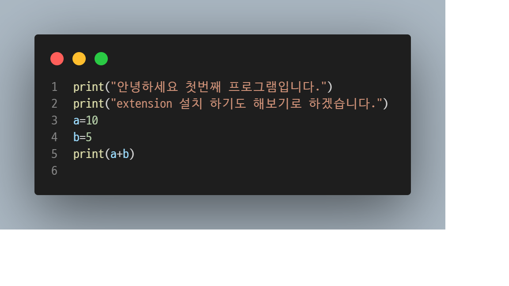
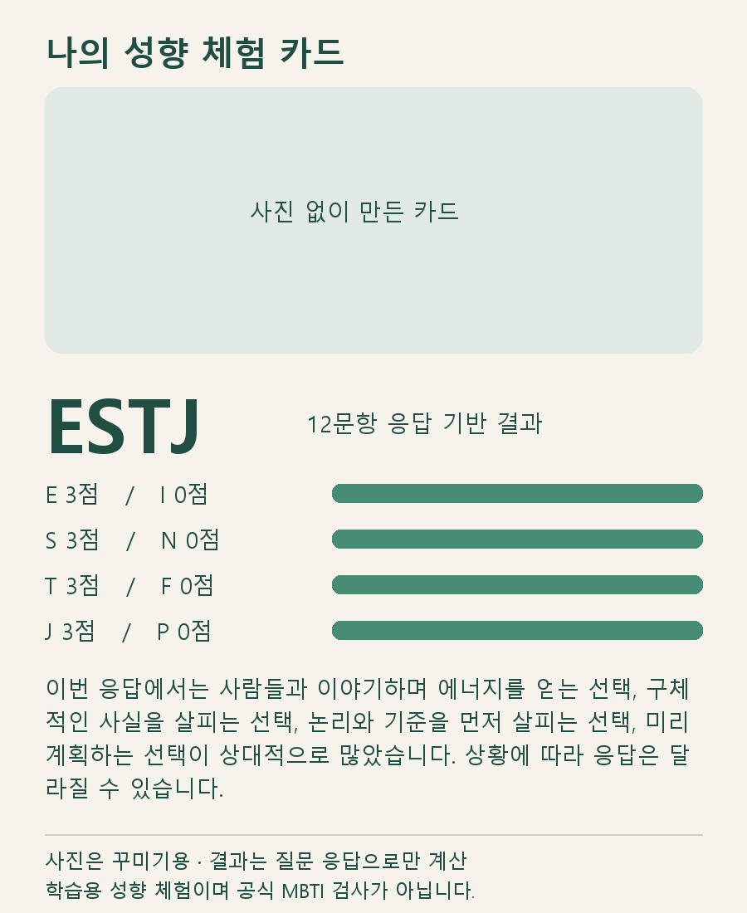

# MBTI 성향 체험 · Python

12문항에 A/B로 응답하는 학습용 콘솔·Tkinter GUI입니다. 공식 MBTI 검사나 진단 도구가 아닙니다.

- mbti_core.py: 4개 지표별 3문항, 점수 계산과 설명
- mbti_test.py: 콘솔 실행
- mbti_GUI.py: 이전/다음, 응답 유지, 결과, 다시 시작
- Gemini에서 실제 코드를 생성한 뒤 입력 검증·해설·화면 크기를 수정했습니다.
- [Gemini 생성 기록](https://gemini.google.com/app/1d8b7ddfc6ec1d46) (계정 접근 필요할 수 있음)

## 실행

Python 3.9 환경에서 `python mbti_test.py` 또는 `python mbti_GUI.py`.
이 컴퓨터에서는 `run.cmd`(GUI), `run-console.cmd`(콘솔)을 더블클릭합니다.
다른 컴퓨터는 `conda env create -f environment.yml` 후 `conda activate mbtiGUI`.

## 확인

4096개 응답 조합에서 16유형 도달, 점수 합계, 미응답 거부, GUI 이전 응답 유지 및 재시작을 확인했습니다.
응답과 사진은 서버로 전송하지 않습니다. 응답은 메모리에만 유지하며, 결과 카드는 사용자가 저장 버튼을 눌렀을 때 PNG 파일로 저장합니다.

## 저장소

https://github.com/junhyeok9679-arch/mbti-python


## 코드 캡처 실습



## 프로필 사진 결과 카드

1. run.cmd로 GUI를 실행합니다.
2. ‘프로필 사진 선택’으로 JPG·PNG·WEBP 사진을 선택합니다 (20MB 이하).
3. 12문항에 답하면 사진, 유형, 지표 점수와 설명이 담긴 카드가 나옵니다.
4. ‘카드 PNG 저장’으로 컴퓨터에 저장합니다.

사진은 선택 사항이며 카드 꾸미기용입니다. 결과는 응답으로만 계산합니다.
사진은 로컬 메모리에서 처리하며 서버에 업로드하지 않습니다. 원본 사진은 수정하지 않고, 저장한 카드에 원본 EXIF를 포함하지 않습니다.
‘사진 지우기’로 제거하거나 결과 화면에서 다른 사진으로 교체할 수 있습니다. 다시 시작하면 사진을 유지하고 응답만 초기화합니다.




## 10월 21일 수업: Git clone 후 로컬 웹 서버

`web_app.py`는 기존 질문·결과 카드 코드를 브라우저에서 실행합니다. Python 3.12 전용 환경 `myfirstProject`에서 `python -m pip install -r requirements-web.txt` 후 `python -m streamlit run web_app.py`로 실행합니다.

이 PC에서는 `run-local.cmd`를 더블클릭하고 http://127.0.0.1:8501 을 엽니다. 사진과 답변은 이 컴퓨터의 서버에서만 처리합니다. 종료는 서버 창에서 Ctrl+C입니다. 기존 데스크톱 GUI는 `run.cmd`로 실행합니다.

웹 서버 소스도 이 저장소에 포함되어 있습니다. 다른 컴퓨터에서는 아래 순서로 준비하세요.

### 다른 컴퓨터에서 웹앱 실행

Git과 Python 3.12를 설치한 뒤 터미널에서 실행합니다.

```powershell
git clone https://github.com/junhyeok9679-arch/mbti-python.git
cd mbti-python
py -3.12 -m venv .venv
.\.venv\Scripts\python.exe -m pip install -r requirements-web.txt
.\.venv\Scripts\python.exe -m streamlit run web_app.py
```

브라우저에서 http://127.0.0.1:8501 을 엽니다. 종료는 서버 터미널에서 Ctrl+C입니다.
`run-local.cmd`는 이 수업 PC의 Miniconda 환경 `myfirstProject`용입니다.
GitHub 웹페이지 자체에서는 Python 서버가 실행되지 않으며, 각 컴퓨터에서 실행해야 합니다.